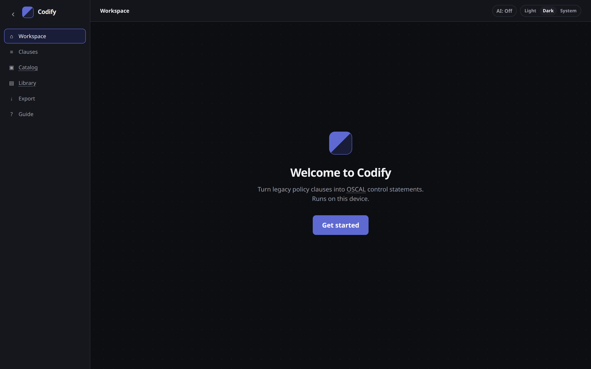

# Introduction

**Codify** turns identified risks and legacy policy clauses into OSCAL 1.1.2 control statements.

Start from the risks you already identified (recommended), or paste a clause. Codify drafts control statements, scores each draft as you edit it, and downloads a catalog you can load in Enact.


Codify runs on your device. Your policy is not uploaded. Rule-based drafts never use AI.


The live app is at [https://code1sentinel.github.io/policy-golden-path/](https://code1sentinel.github.io/policy-golden-path/). You can also run the same page locally (`codify-web`) or use the command line (`codify`). All three ways run the same code.

## Who it is for

- **GRC people** modernising a legacy policy: start from risks or a clause, review the draft, accept it, and keep a catalog in git.
- **Engineers** who want the same conversion in a script or pipeline.

It is not a cloud GRC platform. There is no account, no upload, and no risk register. You may enter [identified risks](identified-risks.md) as input so controls can address them.

## What you get

1. **Sort** — each clause is labelled as a requirement, scope, definition, role, exception, or not a control. Duplicates are flagged.
2. **Draft** — requirements become control statements: the action first, no product names, written so an assessor can test them.
3. **Check** — each draft shows its parts (action, scope, limit, purpose) and a score you can improve as you edit.
4. **Export** — an OSCAL catalog (the usual download), plus Excel, CSV, and a conversion report.

Drafts come from rules, not a model. The same policy always produces the same drafts. They are a starting point to edit, not finished controls.

## Privacy in one line

The default path never sends your policy anywhere. Optional AI drafting is off unless you turn it on, and then only one clause (plus its heading and the rule drafts) goes to the provider you chose, using a key that stays in your browser.

See [Privacy and security](privacy.md).

## Next

- New here? [Getting started](getting-started.md)
- Need a word defined? [Concepts and glossary](concepts.md)
- Contributing to the code? [Contributing](contributing.md)
