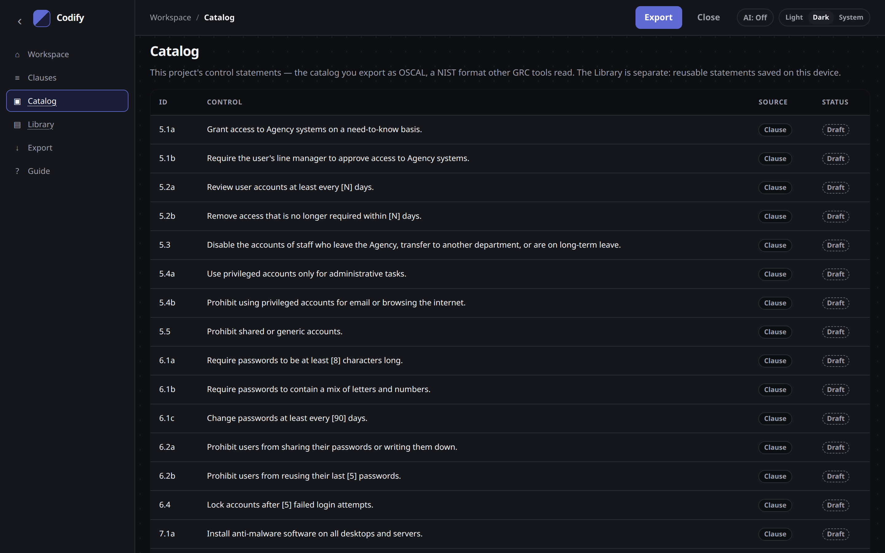
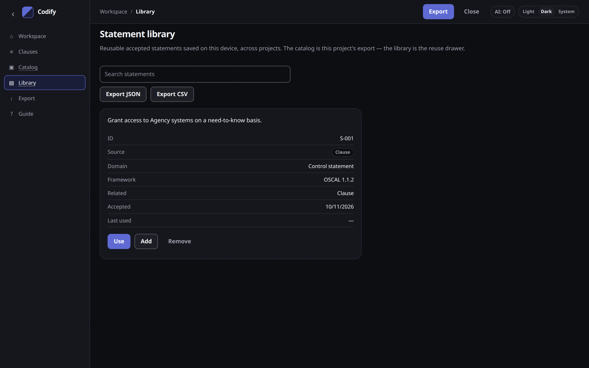

# Catalog and statement library

These are two different stores. The catalog is this project. The library is reusable wording on this device.

## Catalog

The **catalog** is this project's control statements — the set you export as OSCAL.

Open **Catalog** in the sidebar to see every control and the clause it came from.

- One group per policy section, one control per statement
- The file you download is OSCAL 1.1.2 JSON
- Reopening that file resumes the project
- There is no risk register

The catalog is also the save file. Older catalogs that still carry a leftover risk register still open: the register is ignored and the control statements stay.

## Statement library

The **library** holds accepted control statements on this device, across projects.

Accept a control and Codify upserts the statement here (deduped by normalised text). One statement is shown once.

| Action | What it does |
| --- | --- |
| **Use** | Fills the current draft with this wording. You still Accept through the usual score-and-catalog path. |
| **Add** | Adds a new draft from this wording. Same review path. |
| **Remove** | Deletes it from the library only. The catalog is unchanged. |

Nothing in the library is uploaded. It lives under `codify:statements`, separate from the project autosave.

When the library is empty, you will see “No statements saved yet.” Accept a control from the built-in example (or your own clause) and it appears here.

## Side by side

| | Catalog | Library |
| --- | --- | --- |
| Holds | This project's controls | Accepted statements on this device |
| Scope | One policy / one project | Reuse across projects on this machine |
| Export | OSCAL (recommended), Excel, CSV, report | Optional JSON or CSV |
| What Enact reads | The catalog | Never — Enact does not see the library |

See [Using Codify with Enact](enact.md) and [Export formats](export.md).
