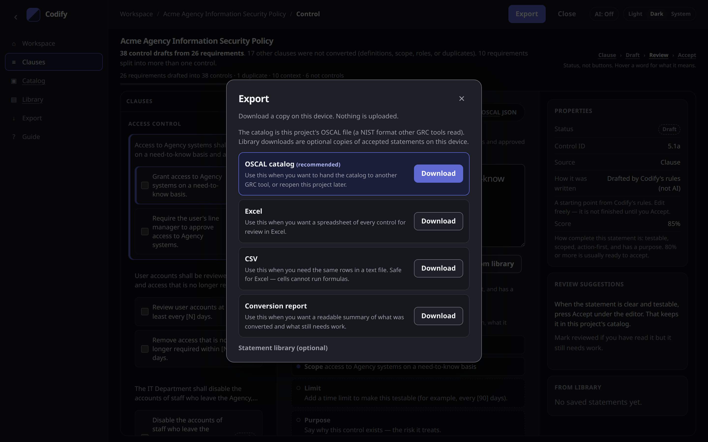

# Export formats

**Export** downloads a copy on this device. Nothing is uploaded.

The dialog marks **OSCAL catalog** as recommended. Each row has a use-when line. Statement-library downloads sit under an optional group.

## When to use each format

| Format | Use when |
| --- | --- |
| **OSCAL catalog** (recommended) | You want to hand the catalog to another GRC tool, put it in git, or reopen this project later. |
| **Excel** | You want a spreadsheet of every control for review in Excel. |
| **CSV** | You need the same rows in a text file. Safe for Excel — cells cannot run formulas. |
| **Conversion report** | You want a readable summary of what was converted and what still needs work. |
| **Statement library JSON** (optional) | You want a JSON copy of accepted statements saved on this device. |
| **Statement library CSV** (optional) | You want those same saved statements as a spreadsheet-safe CSV. |

The library downloads are optional copies of the reuse drawer. They are not the project catalog.

## What is in the OSCAL catalog

JSON, OSCAL 1.1.2. CI checks every catalog Codify writes against NIST's schema.

| In the catalog | From |
| --- | --- |
| Statement part | The control statement. Each `[value]` is a parameter. |
| Guidance part | Tools and how-to moved out of the statement |
| Legacy text | The clause it came from |
| Drafting notes | What the rules changed, and what to decide |
| Properties | Legacy clause, review status, origin, risk it treats, who implements it, linked identified risks (`treats-risk`) |
| Links | `derived-from` the legacy clause; `related` to an identified-risk resource when linked |
| Back matter | Every legacy clause (with its type), plus one resource per identified risk (`title`, description/statement, `status=open`, `identified-risk-id`) |

Codify's own names use the namespace `https://grcengineering.club/ns/codify`.

## Excel and CSV

One row per control (legacy clause, statement, parameters, guidance, risk, who, status, score, notes), then the clauses that did not become controls.

## Conversion report

Markdown. A typical report starts with a line like “43 clauses → 38 controls”, then status, every control with its score, what still needs attention, and the clauses that are not controls — with the reason.

## The editor copy

On a control, the **OSCAL JSON** tab shows that one control so you can read or copy it without downloading the whole file.
