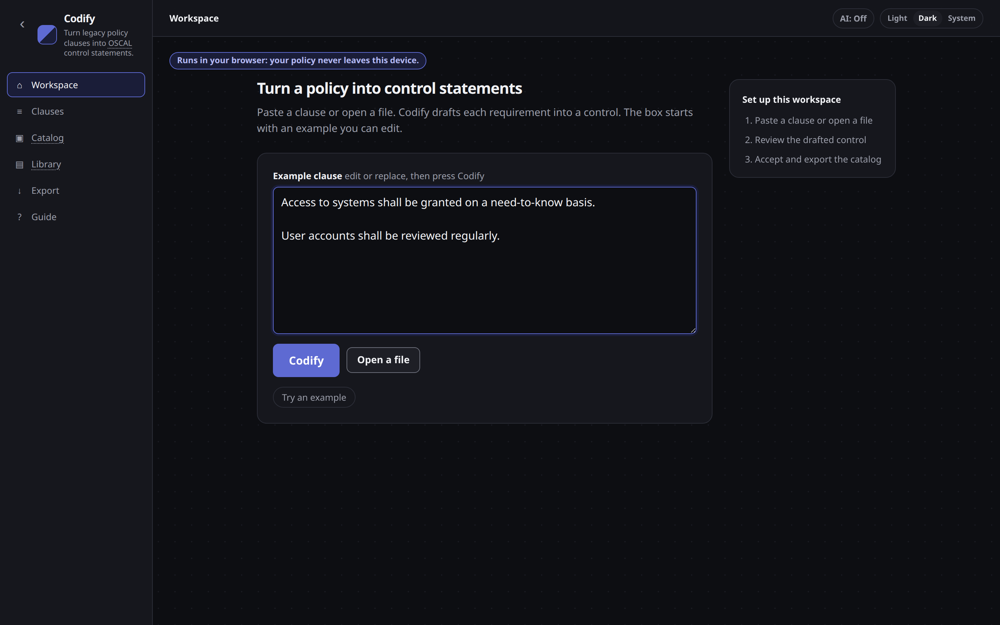
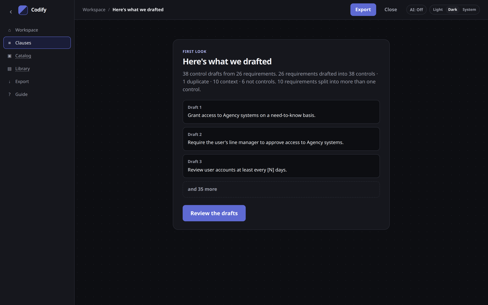

# Getting started

Open the app, choose a starting path, and follow the steps to a catalog you can send to Enact.

## Open the app

| Way | When to use it |
| --- | --- |
| [Online](https://code1sentinel.github.io/policy-golden-path/) | Nothing to install. Codify's Python runs in your browser. The first visit loads about 13 MB; the browser then caches it. |
| Local web app | Same page on this machine only: `codify-web --open` → http://127.0.0.1:8765/ |
| Command line | Scripts and pipelines — see [Command line and Python](cli.md) |

The online site and the local web app look the same. Neither loads fonts or other assets from a third party.

## First visit

The first open is two side-by-side flow cards. Each has a one-line title, a mini step diagram, and **Get started**.

A saved project on this device shows the same cards with a small **Resume** link.

## Choose how to start

- **Identify risk → Control statement** — enter identified risks, then write control statements that treat them. **Get started** opens the risk entry step.
- **Policy clause → Control statement** — paste a clause (or try the example). **Get started** opens the clause box. Codify drafts as before; then you link each draft to a risk.

Both flows end at **Policy as code (Rego)**. A muted line on the landing explains the catalog is exported as OSCAL and tested as Rego in [Enact](enact.md).

Both paths share **Review** and **Send to Enact**. Every risk needs a control statement; every control must be linked to a risk.



On the clause path, the box already contains a real example you can edit or replace:

```
Access to systems shall be granted on a need-to-know basis.

User accounts shall be reviewed regularly.
```

Press **Codify**. There is no Title field, and clause numbers are optional.

You can also:

- Choose **Open a file** for Word (`.docx`), CSV or Excel (`.xlsx`), Markdown or text, or a saved OSCAL catalog (`.json`).
- Choose **Try an example** to load the fictional **Acme demo policy** (a 2016-style agency policy written with typical legacy problems).

PDF is not read: copy the text and paste it.


**Try an example** uses only the built-in Acme demo. It never sends the policy anywhere.


## Here's what we drafted

After paste or **Try an example**, Codify shows a short result step before the full workspace.



You will see:

- How many **control drafts** came from how many **requirements**
- A breakdown of other clauses (duplicates, context, not controls)
- The first few drafts (Draft 1–3), then **and N more** when there are more
- **Review the drafts** — opens the workspace

The drafts are a first pass. Edit them in the next step.

## What happens to a clause

| Kind of clause | What Codify does |
| --- | --- |
| Requirement (`shall`, `must`, a present-tense rule, …) | Becomes one or more control statements |
| Scope (“This policy applies to…”) | Catalog “Applies to” |
| Definition | Catalog back matter |
| Role (“is responsible…”) | Who implements it — not a control |
| Exception | Catalog metadata |
| Not a control (aspirations, consequences, permissions) | Listed in the conversion report only |
| Duplicate of an earlier requirement | Flagged; no control of its own |

You can change a clause's type later. Making it a requirement drafts controls for it.

## Next

[Review the drafts](reviewing-controls.md) in the workspace. Coverage and [identified risks](identified-risks.md) are required before you [send the catalog to Enact](enact.md).
