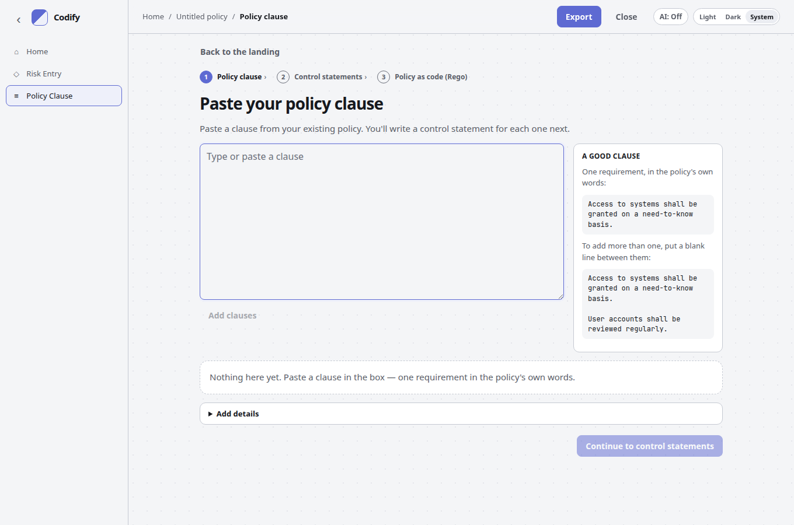

# Getting started

Open the app, choose a starting path, and follow the steps to a catalog you can send to Enact.

## Open the app

| Way | When to use it |
| --- | --- |
| [Online](https://code1sentinel.github.io/policy-golden-path/) | Nothing to install. Codify's Python runs in your browser. The first visit loads about 13 MB; the browser then caches it. |
| Local web app | Same page on this machine only: `codify-web --open` → http://127.0.0.1:8765/ |
| Command line | Scripts and pipelines — see [Command line and Python](cli.md) |

The online site and the local web app look the same. Neither loads fonts or other assets from a third party.

## First visit

The first open is a product landing: a short headline, a mock of a risk becoming a control (then OSCAL and Rego), and two start buttons.

**Get started with identified risks** opens the risk-first flow (Identify risks). **Get started with an existing policy clause** opens **Paste your policy clause**. A saved project on this device shows **Resume your project** in the top bar.

## Choose how to start

- **Get started with identified risks** — opens **What risks have you identified?** Type each risk in **Add a risk** (Enter adds), then **Continue to control statements**. Write a statement for each risk, then **Continue to policy as code**.
- **Get started with an existing policy clause** — opens **Paste your policy clause**. Paste a clause from your existing policy (a blank line separates several). **Continue to control statements**, then write a statement for each clause and link each draft to a risk.

Both flows end at **Policy as code (Rego)** in [Enact](enact.md).

Both paths share **Policy as code (Rego)**. Every risk needs a control statement; every control must be linked to a risk.

On the clause path there is no Title field, and clause numbers are optional. PDF is not read: copy the text and paste it.

The command line still reads Word, CSV, Excel, Markdown, and saved OSCAL catalogs (`codify POLICY`).

## What happens to a clause

| Kind of clause | What Codify does |
| --- | --- |
| Requirement (`shall`, `must`, a present-tense rule, …) | Becomes one or more control statements |
| Scope (“This policy applies to…”) | Catalog “Applies to” |
| Definition | Catalog back matter |
| Role (“is responsible…”) | Who implements it — not a control |
| Exception | Catalog metadata |
| Not a control (aspirations, consequences, permissions) | Listed in the conversion report only |
| Duplicate of an earlier requirement | Flagged; no control of its own |

You can change a clause's type later. Making it a requirement drafts controls for it.

## Next

[Review the drafts](reviewing-controls.md) in the workspace. Coverage and [identified risks](identified-risks.md) are required before you [send the catalog to Enact](enact.md).
