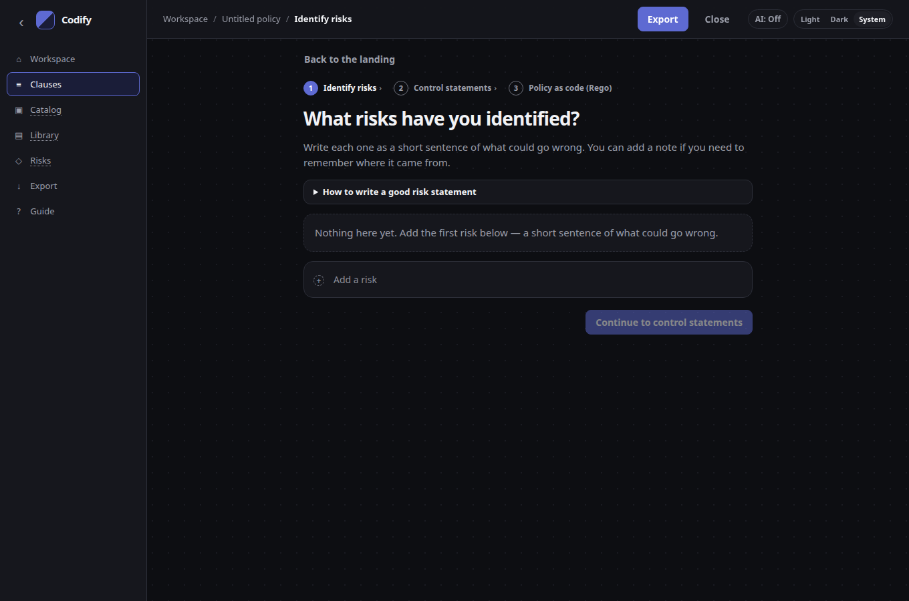

# Identified risks

Identified risks are **input** to authoring. You enter the risks you already have; control statements exist to address them. On the web, they are required before Review and export ([ADR 0013](https://github.com/code1sentinel/policy-golden-path/blob/main/docs/adr/0013-risk-first-authoring-flow.md)).

This is not a risk register. There are no scores, likelihood or impact, owners, review cycles, or treatment plans.

## Add risks

**Get started with identified risks** on the landing opens a page that asks **What risks have you identified?** You can also add risks on the **Link to risks** step after **Get started with an existing policy clause**, or choose **Risk Entry** in the nav.

1. Type a short statement in **Add a risk** (what could go wrong) and press Enter. Esc clears the draft.
2. Edit a row in place. Optionally add a note if you need to remember where it came from.
3. **Continue to control statements** stays off until at least one risk is in the list.

A short **How to write a good risk statement** tip is collapsed until you open it. A small step indicator shows Identify risks → Control statements → Policy as code (Rego). **Back to the landing** returns to the marketing landing.

Each risk still gets an id (`R-001`, `R-002`, …) in the project; this page does not show those as a register. **Remove** drops the link on controls; the control statements stay.

Work is stored with the project (`codify:project`). Nothing is uploaded.

## Suggest statements

For a risk, **Suggest statements** opens a dialog (scenario at the top, recommended wording below):

- Matching statements come from the [statement library](catalog-and-library.md) on this device. Matching is local (shared words).
- **Add** puts that wording on a control and links it to the risk.
- **Not now** closes the dialog. **Add statements** adds every listed match.
- If optional [AI assist](ai-assist.md) is already on, **Also draft with AI** uses the same existing drafting path (the risk statement is the prompt text). No new endpoint, and keys stay in the browser.

## Coverage

The Risks view flags:

- Identified risks with **no control**
- Controls **not linked** to any identified risk

The related-controls table lists risk, scenario, control, and status. Uncovered and unlinked rows are marked.

This is a coverage flag, not a score.

## Risk it treats

On a control, **Risk it treats** is still the purpose of the statement — why it exists. When the control is linked to identified risks, that field shows the linked statement(s).

Mapped risks also appear on the control (id, statement, unlink), next to guidance and who.

## Export

The OSCAL catalog traces each link:

- A back-matter resource per identified risk: short `title`,
  `description` / `statement`, `status=open`, and `identified-risk-id`
- On the control, a `treats-risk` property and a `rel=related` link

Older catalogs that still carry a leftover **register** (`risk-id` resources, likelihood, scores) open with an empty identified-risks list. The [control statements](catalog-and-library.md) remain.

See [Export formats](export.md) and [Using Codify with Enact](enact.md). The web wizard blocks catalog download until every risk has a control statement and every control is linked.
