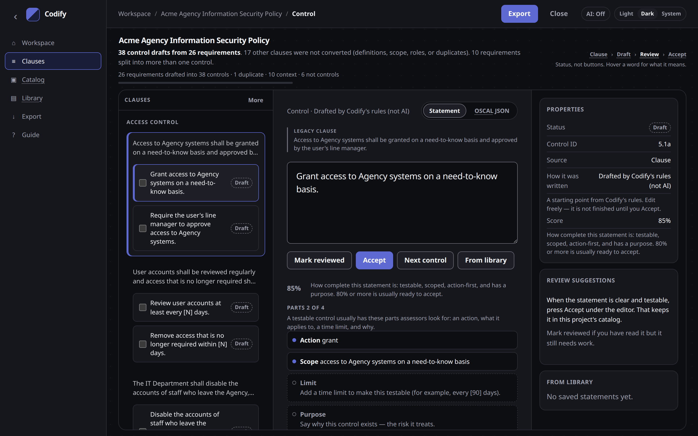

# Reviewing controls

The workspace is where you edit a draft next to the original clause, fill any blanks, and accept the wording you want to keep.

## The workspace

The page is an authoring app:

- **Nav** — Home, Risk Entry, Policy Clause
- **Writing column** — the control statement, with the legacy clause above it
- **Right panel** — status, score, and review hints

**Home** returns to the landing. **Risk Entry** opens Identify risks (step 1). **Policy Clause** opens **Paste your policy clause** (step 1). Identify risks is a capture page (three landing steps, back to the landing, Continue when at least one risk exists). Policy clause is the matching capture page: a large paste box, a small example, a list of clauses, Continue when at least one clause exists. Control statements is a split list + editor: write a statement for each risk or clause, then **Continue to policy as code** when every item is covered. Later steps still use a numbered stepper: Link to risks (clause path), then Review and Send to Enact, with a short guide you can hide and open again. Catalog, library, and export stay inside those flows (OSCAL from step 3, Insert from library).

A pasted project is named from the first clause. You can rename it at the top of the workspace.

The strip **Clause → Draft → Review → Accept** in the editor is status, not a set of links. Hover a word for what it means. The stepper above is the authoring path and *is* a set of steps.

## Parts of a statement

A testable control usually has four parts assessors look for:

| Part | What to write |
| --- | --- |
| **Action** | Start with the verb (Review, Restrict, Encrypt). |
| **Scope** | What it applies to (which systems, people, or data). |
| **Limit** | A time limit that makes it testable (for example, every [90] days). |
| **Purpose** | Why the control exists — **the risk it treats**. |

Those parts appear once under the statement. Missing ones are easy to see.

Under **Guidance, risk, who** you can add tools or how-to examples, who implements the control, and a short line for the risk it treats. If you have [identified risks](identified-risks.md), link them here; the purpose field then shows the linked statement. Those extras sit in the catalog; they do not replace the statement.

## Score

The score is how complete the statement is as a catalog control: testable, scoped, action-first, and with a purpose. **80% or more is usually ready to accept.**

A score describes how a statement is written, not whether it is true. After you accept, remaining gaps are labelled as optional improvements.

The in-app **Guide** shows a weak and a strong example for each practice.

## Set this value — `[N]` blanks

Vague timing in the source (“regularly”, “timely”) becomes a parameter: `at least every [N] days` or `within [N] days`.

Unfilled blanks show as **Set this value** prompts. Type the number your organisation will test against — for example `90` — and press **Set**.

A filled value looks like `[90]`. That value becomes a parameter in the exported catalog.

## Accept, undo, and mark reviewed

| Action | What it means |
| --- | --- |
| **Accept** | Keep this statement in this project's catalog and on this device (the [statement library](catalog-and-library.md)). |
| **Accepted ✓** | Shown after Accept. **Next control** becomes the primary action. |
| **Undo accept** | Returns the control to draft. The statement stays in the library until you remove it there. |
| **Mark reviewed** | You have read the draft. It still needs work. Use Accept when the wording is good enough to keep. |
| **Next control** | Open the next control. Before Accept it does not accept this one. |

Accept is the single primary action until the control is accepted.

Keyboard (when you are not typing in a field):

- <kbd>j</kbd> / <kbd>k</kbd> or arrows — next and previous
- <kbd>r</kbd> — mark reviewed
- <kbd>a</kbd> — accept
- <kbd>⌘</kbd> / <kbd>Ctrl</kbd>+<kbd>Enter</kbd> — accept (also from the statement field)

## Filters and bulk actions

Under **More** in the clause list:

- Filters: All, Drafts, Reviewed, Accepted, Below 80%, Not converted
- **Select ready drafts** — drafts scoring 80% or more with no notes left to decide
- **Select shown** — every control the current filter shows

Then mark the selection reviewed or accepted (or, if AI is on, draft again with AI).

## Statement and OSCAL JSON

Tabs on the current control:

- **Statement** — the wording you edit
- **OSCAL JSON** — this control as OSCAL, with a local **Copy**. Nothing is uploaded.

## Saving as you go

Work is kept in your browser as you type (`codify:project`). Use [Export](export.md) when you want a file you can keep, share, or put in git.
